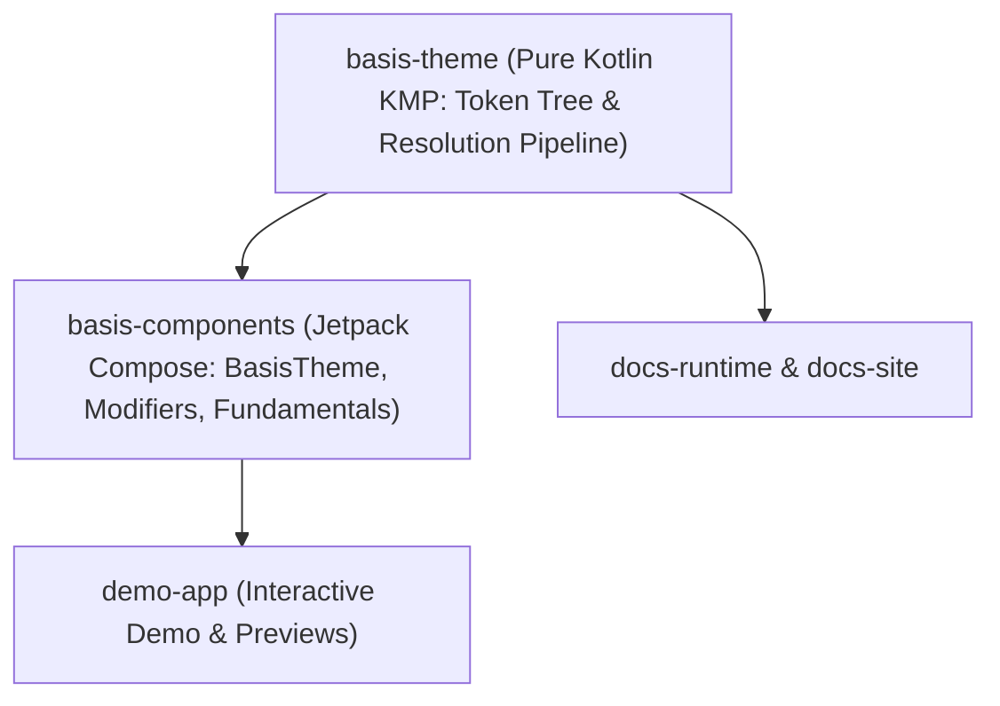

# Contributing to Basis

Basis is a Jetpack Compose design system, published to Maven Central under `io.github.alph_a07`.

Conventions, architecture rules and the KDoc standard live in [AGENTS.md](AGENTS.md). This file covers the mechanics of getting a change through: the toolchain, component development standards, enforced checks, and traps in each.

---

## Setup

JDK 21 (`build-logic` owns the level; `foojay` fetches it if your JDK differs). Use `./gradlew` — the wrapper pins the version.

```bash
git clone https://github.com/alph-a07/basis.git
cd basis
./gradlew installGitHooks
```

`installGitHooks` points `core.hooksPath` at `.githooks`. Without it the local checks never run.

In the IDE, enable EditorConfig support and reformat-on-save; both read the same `.editorconfig` ktlint does. Leave *Rearrange code* and *Run code cleanup* off — neither has a CI equivalent, so they only add diff noise.

---

## Layout & Architecture

Dependencies flow strictly in one direction:



| Module | Role |
| --- | --- |
| `basis-theme` | Pure Kotlin Multiplatform (`jvm`, `js`) tokens and resolution engine. No Compose, no Android. |
| `basis-components` | The published Android Compose library (`io.github.alph_a07:basis-components`). Holds `BasisTheme`, foundation modifiers, converters. |
| `demo-app` | Interactive Android sample application and previews (`io.github.alph_a07:demo-app`). |
| `basis-lint` | Custom Detekt and lint rules (`io.github.alph-a07:basis-detekt-rules`). |
| `docs-runtime` | Pure Kotlin Multiplatform facade exposing resolution engine and CSS emission to JS/Node. |
| `build-logic` | Convention plugins. **An included build, not a subproject.** |

`build-logic` being an included build means the root `detekt` and `ktlintCheck` do not reach it. Any change to a convention plugin needs `-p build-logic` or it ships unchecked — or run [`verifyAll`](#checks), which covers it.

---

## Building a Component

All Basis components are constructed following the **T0/T1/T2 hierarchy**:

- **T0 (Private Primitives):** Indivisible interaction/visual atoms (indication ripple, focus ring, min touch target, content color). Never ship as public API.
- **T1 (Public Fundamentals):** Foundation building blocks for apps and higher components (`basisSurface`, `basisClickable`, `basisSelectable`, `basisToggleable`, `basisMinTouchTarget`, `basisFocusRing`, `basisBorder`).
- **T2 (Core Controls):** Atomic catalog components (`BasisButton`, `BasisTextField`, etc.) composed strictly from T0/T1 and resolved tokens.

### Strict Engineering Invariants

1. **No Hardcoded Tokens:** Never use raw hex strings (`#0284C7`), raw font sizes, raw elevation `dp`, or raw animation timings. All visual and spatial values must resolve from `BasisTheme`.
2. **Accessible by Construction:** Every interactive element must satisfy the 48dp minimum touch target floor (`Modifier.basisMinTouchTarget()`), provide semantic accessibility roles (`Role.Button`, `Role.Checkbox`), and render theme focus rings (`Modifier.basisFocusRing()`).
3. **Foundation Composition:** Composables do not inherit implementation classes. Compose components by applying foundation modifiers to foundational slots.
4. **Style Resolution:** When component overrides or variants exist, resolve appearance via `resolveComponentStyle`:

```kotlin
val resolvedStyle = resolveComponentStyle(
    id = ComponentId.Interactive,
    variant = variantId,
    state = stateId,
    patches = BasisTheme.componentOverrides,
    theme = BasisTheme.current,
)
```

5. **Authoring Skill:** Follow [.agents/skills/basis-create-component/SKILL.md](.agents/skills/basis-create-component/SKILL.md) for full naming, KDoc, and verification rules.

### Reference Implementation Pattern

```kotlin
package io.github.alph_a07.basis.components.button

import androidx.compose.foundation.layout.Box
import androidx.compose.foundation.layout.padding
import androidx.compose.foundation.shape.RoundedCornerShape
import androidx.compose.foundation.text.BasicText
import androidx.compose.runtime.Composable
import androidx.compose.ui.Alignment
import androidx.compose.ui.Modifier
import androidx.compose.ui.semantics.Role
import io.github.alph_a07.basis.components.foundation.modifier.basisClickable
import io.github.alph_a07.basis.components.foundation.modifier.basisFocusRing
import io.github.alph_a07.basis.components.foundation.modifier.basisMinTouchTarget
import io.github.alph_a07.basis.components.foundation.modifier.basisSurface
import io.github.alph_a07.basis.components.theme.BasisTheme
import io.github.alph_a07.basis.components.theme.conversion.toDp

/**
 * Atomic core button adhering to Basis foundation conventions.
 *
 * @param onClick Callback invoked on button press.
 * @param modifier Composable modifier chain.
 * @param label Button text content.
 */
@Composable
public fun BasisButton(
    onClick: () -> Unit,
    modifier: Modifier = Modifier,
    label: String,
) {
    val buttonShape = RoundedCornerShape(BasisTheme.radius.level2.toDp())

    Box(
        modifier =
            modifier
                .basisSurface(
                    shape = buttonShape,
                    color = BasisTheme.colors.brand.primary,
                )
                .basisFocusRing(shape = buttonShape)
                .basisClickable(role = Role.Button, onClick = onClick)
                .basisMinTouchTarget()
                .padding(
                    horizontal = BasisTheme.spacing.level4.toDp(),
                    vertical = BasisTheme.spacing.level3.toDp(),
                ),
        contentAlignment = Alignment.Center,
    ) {
        BasicText(
            text = label,
            style = BasisTheme.typography.content.level1.copy(
                color = BasisTheme.colors.content.inverse,
            ),
        )
    }
}
```

---

## Workflow

Branch from `main` as `feature|bugfix|enhancement/Issue-<n>`. Commits and PR titles use [Conventional Commits](https://www.conventionalcommits.org/) (`feat(button): add pill-shaped variant`), at most 88 characters, with `!` for breaking. The PR title's type must match the branch — `bugfix/` requires `fix`.

---

## Gradle Tasks & Checks

Basis uses Gradle conventions defined in `build-logic` (`verify-all-conventions.gradle.kts`) to lift nested subproject tasks into clean, root-level commands.

### Unified Pipeline & Lifted Tasks (Root)

| Command | Group | Scope & Description |
| --- | --- | --- |
| `./gradlew verifyAll` | `verification` | **CI Gate:** Runs `assemble`, `test`, `lint`, `detekt`, `ktlintCheck`, and `releaseApiCheck` across all modules and `build-logic`. |
| `./gradlew fixAll` | `formatting` | **Auto-Fix Gate:** Runs `ktlintFormat` and `lintFix` across all modules and `build-logic`. |
| `./gradlew tests` | `verification` | **Test Suite:** Runs all JVM/JS unit tests and executes connected Android instrumentation tests (`connectedDebugAndroidTest`) on online devices/emulators. |
| `./gradlew releaseApiCheck` | `verification` | **[Lifted]** Validates public Binary Compatibility Validator (BCV) dumps against committed baselines (`basis-components/api/basis-components.api`). |
| `./gradlew releaseApiDump` | `verification` | **[Lifted]** Dumps current public ABI signatures to committed baseline files across modules. |
| `./gradlew detekt` | `verification` | Runs Detekt static analysis with type resolution across all subprojects. |
| `./gradlew ktlintCheck` | `verification` | Enforces `.editorconfig` formatting rules across all Kotlin source files. |
| `./gradlew ktlintFormat` | `formatting` | Auto-formats Kotlin source code according to `.editorconfig`. |
| `./gradlew updateGolden` | `verification` | **[Lifted]** Updates JVM parity golden test fixtures (`ParityGoldens.kt`) in `:basis-theme`. |
| `./gradlew generateIntentJson` | `documentation` | **[Lifted]** Generates `intent.json` schema from `basis-theme` Kotlin sources and KDoc. |
| `./gradlew generatePatchVocabulary` | `documentation` | **[Lifted]** Generates `patch-vocabulary.json` schema from style patches and token ladders. |

---

### Module Tasks Catalog

#### 1. `:basis-theme` (Pure Kotlin Multiplatform)
Core design tokens and theme resolution pipeline for JVM and JS/Node targets.

| Task | Category | Description |
| --- | --- | --- |
| `./gradlew :basis-theme:allTests` | Verification | Runs tests across all targets (JVM + JS Node) and produces an aggregated HTML report. |
| `./gradlew :basis-theme:jvmTest` | Verification | Executes JVM test suite (resolution engine, color conversions, typography, token trees). |
| `./gradlew :basis-theme:jsNodeTest` | Verification | Executes Kotlin/JS test suite inside Node.js with the builtin test framework. |
| `./gradlew :basis-theme:test` | Verification | Runs multiplatform test lifecycle. |
| `./gradlew :basis-theme:updateGolden` | Verification | Re-generates expected parity golden references in `ParityGoldens.kt`. |
| `./gradlew :basis-theme:compileKotlinJvm` | Build | Compiles JVM source sets with KSP metadata. |
| `./gradlew :basis-theme:compileKotlinJs` | Build | Compiles JS source sets for browser and Node.js. |
| `./gradlew :basis-theme:jvmJar` | Build | Packages JVM artifact JAR. |
| `./gradlew :basis-theme:jsJar` | Build | Packages Kotlin/JS artifact JAR. |
| `./gradlew :basis-theme:kspKotlinJvm` | Build | Executes KSP code generators for JVM target. |
| `./gradlew :basis-theme:detekt` | Verification | Runs Detekt static analysis on `:basis-theme`. |
| `./gradlew :basis-theme:ktlintCheck` | Verification | Checks Kotlin formatting on `:basis-theme`. |
| `./gradlew :basis-theme:ktlintFormat` | Formatting | Auto-formats Kotlin code in `:basis-theme`. |

#### 2. `:basis-components` (Jetpack Compose Android Library)
Published Compose design system library (`io.github.alph_a07:basis-components`).

| Task | Category | Description |
| --- | --- | --- |
| `./gradlew :basis-components:assemble` | Build | Assembles main library outputs (AAR) for all build variants. |
| `./gradlew :basis-components:assembleDebug` | Build | Assembles debug AAR artifact. |
| `./gradlew :basis-components:assembleRelease` | Build | Assembles release AAR artifact. |
| `./gradlew :basis-components:testDebugUnitTest` | Verification | Executes local JVM Compose unit tests and foundation semantics assertions. |
| `./gradlew :basis-components:test` | Verification | Runs all unit test variants. |
| `./gradlew :basis-components:connectedDebugAndroidTest` | Verification | Runs Android on-device/emulator instrumentation tests (accessibility, touch targets, focus). |
| `./gradlew :basis-components:releaseApiCheck` | Verification | Diff public ABI against committed `basis-components/api/basis-components.api`. |
| `./gradlew :basis-components:releaseApiDump` | Verification | Dumps updated public API contract to `basis-components/api/basis-components.api`. |
| `./gradlew :basis-components:lint` | Verification | Runs Android Lint analysis on default variant. |
| `./gradlew :basis-components:lintDebug` | Verification | Runs Android Lint report on debug variant. |
| `./gradlew :basis-components:lintFix` | Formatting | Applies safe Android Lint auto-fixes to source files. |
| `./gradlew :basis-components:detekt` | Verification | Runs Detekt analysis on `:basis-components`. |
| `./gradlew :basis-components:ktlintCheck` | Verification | Checks Kotlin formatting on `:basis-components`. |
| `./gradlew :basis-components:ktlintFormat` | Formatting | Auto-formats Kotlin code in `:basis-components`. |

#### 3. `:demo-app` (Android Showcase Application)
Interactive showcase app with live theme switching, component previews, and state controls.

| Task | Category | Description |
| --- | --- | --- |
| `./gradlew :demo-app:assembleDebug` | Build | Builds debug APK (`app-debug.apk`). |
| `./gradlew :demo-app:assembleRelease` | Build | Builds release APK. |
| `./gradlew :demo-app:installDebug` | Install | Builds and installs debug APK onto first available connected device/emulator. |
| `./gradlew :demo-app:uninstallAll` | Install | Uninstalls demo app from connected devices. |
| `./gradlew :demo-app:testDebugUnitTest` | Verification | Executes local unit tests for demo app. |
| `./gradlew :demo-app:connectedDebugAndroidTest` | Verification | Executes on-device UI instrumentation tests. |
| `./gradlew :demo-app:lint` | Verification | Runs Android Lint analysis on default variant. |
| `./gradlew :demo-app:lintFix` | Formatting | Applies safe Android Lint fixes. |
| `./gradlew :demo-app:detekt` | Verification | Runs Detekt static analysis on `:demo-app`. |
| `./gradlew :demo-app:ktlintCheck` | Verification | Checks Kotlin formatting on `:demo-app`. |
| `./gradlew :demo-app:ktlintFormat` | Formatting | Auto-formats Kotlin code in `:demo-app`. |

#### 4. `:basis-lint` (Custom Lint & Detekt Rules)
Custom Detekt rules enforcing Basis architectural invariants (`io.github.alph-a07:basis-detekt-rules`).

| Task | Category | Description |
| --- | --- | --- |
| `./gradlew :basis-lint:test` | Verification | Runs unit tests asserting custom Detekt rules against code snippets. |
| `./gradlew :basis-lint:classes` | Build | Compiles rule classes. |
| `./gradlew :basis-lint:jar` | Build | Packages custom rules into distributor JAR. |
| `./gradlew :basis-lint:detekt` | Verification | Runs Detekt static analysis on `:basis-lint`. |
| `./gradlew :basis-lint:ktlintCheck` | Verification | Checks Kotlin formatting on `:basis-lint`. |
| `./gradlew :basis-lint:ktlintFormat` | Formatting | Auto-formats Kotlin code in `:basis-lint`. |

#### 5. `:docs-runtime` (Documentation KMP Runtime)
Multiplatform runtime facade exposing theme resolution and CSS token emission to JS/Node.

| Task | Category | Description |
| --- | --- | --- |
| `./gradlew :docs-runtime:allTests` | Verification | Runs all multiplatform tests for documentation runtime. |
| `./gradlew :docs-runtime:jvmTest` | Verification | Runs JVM tests for token emission. |
| `./gradlew :docs-runtime:jsNodeTest` | Verification | Runs Node.js test suite for JS runtime bindings. |
| `./gradlew :docs-runtime:assemble` | Build | Assembles library outputs for all platforms. |
| `./gradlew :docs-runtime:jsBrowserProductionLibraryDistribution` | Distribution | Builds optimized browser library bundle. |
| `./gradlew :docs-runtime:jsNodeProductionLibraryDistribution` | Distribution | Builds optimized Node.js library bundle. |
| `./gradlew :docs-runtime:detekt` | Verification | Runs Detekt static analysis on `:docs-runtime`. |
| `./gradlew :docs-runtime:ktlintCheck` | Verification | Checks Kotlin formatting on `:docs-runtime`. |
| `./gradlew :docs-runtime:ktlintFormat` | Formatting | Auto-formats Kotlin code in `:docs-runtime`. |

#### 6. `:docs:docs-extract` (Docs Vocabulary & Schema Generation)
Tools to extract intent vocabularies and theme schema from Kotlin sources and KDoc.

| Task | Category | Description |
| --- | --- | --- |
| `./gradlew :docs:docs-extract:generateIntentJson` | Documentation | Extracts intent mappings from `basis-theme` into `intent.json`. |
| `./gradlew :docs:docs-extract:generatePatchVocabulary` | Documentation | Extracts style patch vocabulary and token ladders into `patch-vocabulary.json`. |
| `./gradlew :docs:docs-extract:test` | Verification | Runs extraction validation unit tests. |
| `./gradlew :docs:docs-extract:jar` | Build | Packages extractor tool into executable JAR. |
| `./gradlew :docs:docs-extract:detekt` | Verification | Runs Detekt static analysis on `:docs:docs-extract`. |
| `./gradlew :docs:docs-extract:ktlintCheck` | Verification | Checks Kotlin formatting on `:docs:docs-extract`. |
| `./gradlew :docs:docs-extract:ktlintFormat` | Formatting | Auto-formats Kotlin code in `:docs:docs-extract`. |

#### 7. `build-logic` (Included Build: Convention Plugins, KSP & Rules)
Convention plugins and compiler extensions that power the build system.

> [!NOTE]
> `build-logic` is an included build (`includeBuild("build-logic")`). You can run tasks directly inside it via `-p build-logic` or leverage root-level lifted tasks.

| Task | Category | Description |
| --- | --- | --- |
| `./gradlew -p build-logic test` | Verification | Runs unit tests across all convention plugins, KSP processors, and rules. |
| `./gradlew -p build-logic detekt` | Verification | Runs Detekt static analysis on convention plugins. |
| `./gradlew -p build-logic ktlintCheck` | Verification | Validates formatting across `build-logic` Gradle Kotlin DSL scripts. |
| `./gradlew -p build-logic ktlintFormat` | Formatting | Formats `build-logic` scripts and sources. |
| `./gradlew :build-logic:basis-theme-ksp:test` | Verification | Tests the Basis theme KSP token code generator. |
| `./gradlew :build-logic:basis-detekt-rules:test` | Verification | Tests custom detekt rules defined in `build-logic`. |

---

## Traps

**Binary Compatibility (BCV) baseline dumps.** Run `./gradlew releaseApiCheck` (lifted to root) to diff against the committed baseline. If an intentional public API addition was made, dump the updated contract with `./gradlew releaseApiDump` and commit `basis-components/api/basis-components.api`.

**ktlint's `filter { exclude(...) }` does nothing.** It registers a pattern on a `PatternFilterable` the plugin never applies to the task's file collection. Excluding build output means retargeting the task's `source`, as `build-logic/build.gradle.kts` does.

**ktlint reports are not always cleared.** Hundreds of violations in `build/generated-sources` usually means a stale report, not a real regression:

```bash
rm -rf build-logic/build/reports/ktlint build-logic/build/intermediates/ktLint
```

**detekt findings are semantic, not cosmetic.** Fix the code. If a rule is genuinely wrong for this codebase, disable that one rule in `detekt.yml` with a comment; disabling a ruleset to clear a single finding hides the next one too. `build.maxIssues` stays at `0`.

---

## License

Apache 2.0. See [LICENSE](LICENSE).
