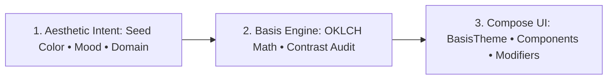

Basis is a modern design system for Jetpack Compose that automates token derivation, dark mode harmony, and WCAG accessibility compliance from high-level brand intent.

Instead of handcrafting hundreds of static color hexes and wrestling with broken dark-mode contrast, you declare your brand seed and aesthetic goals. Basis computes a mathematically verified design system with guaranteed contrast, standardized touch targets, and natural tonal depth.



## Core Tenets

Basis is engineered around three non-negotiable guarantees:

1. **System Over Manual Specs**: Define visual intent once. All container fills, interactive state layers (hover, press, focus, disable), and border hairlines derive automatically without manual synchronization.
2. **Accessible by Construction**: Contrast ratios ($\ge 4.5:1$ for body text, $\ge 3:1$ for controls) are enforced algorithmically during theme resolution. Interactive elements strictly enforce 48dp physical touch target floors.
3. **Tonal Dark Mode**: Replaces invisible drop shadows with luminous surface lightness steps, creating natural physical depth on OLED and LCD screens alike.

## What's Included

The system ships in three cohesive layers designed for Android and multiplatform projects:

| Layer | Module | Description |
| :--- | :--- | :--- |
| **Components** | `basis-components` | Accessible composables (`BasisButton`, `BasisDivider`) with built-in state machines. |
| **Foundation** | `basis-components` | Atomic modifiers (`Modifier.surface()`, `.focusRing()`, `.touchTarget()`) for custom layouts. |
| **Theming Engine** | `basis-theme` | Pure KMP resolution compiler generating token trees from intent. |
| **Lint Rules** | `basis-lint` | Detekt rules preventing hardcoded hexes, missing touch targets, and convention drift. |

## Quick Example

Wrap your Compose hierarchy in `BasisTheme` to access semantic tokens and components:

```kotlin
@Composable
fun App() {
    // Automatically synchronizes with Android system light/dark mode
    BasisTheme(mode = ThemeMode.System) {
        Column(
            modifier = Modifier
                .fillMaxSize()
                .padding(BasisTheme.spacing.lg)
        ) {
            Text(
                text = "Workspace",
                style = BasisTheme.typography.headlineLarge,
                color = BasisTheme.colors.onSurface
            )

            Spacer(modifier = Modifier.height(BasisTheme.spacing.md))

            BasisButton(
                onClick = { /* trigger action */ },
                variant = BasisButtonDefaults.variantPrimary()
            ) {
                Text("Deploy Application")
            }
        }
    }
}
```

## Documentation Roadmap

- [Installation](/docs/getting-started/installation): Add Basis dependencies and plugins to Gradle.
- [Quickstart](/docs/getting-started/quickstart): Build your first themed screen in under five minutes.
- [Theming Architecture](/docs/theming/overview): Explore the intent-to-token compilation model.
- [Components](/docs/components/button): Inspect production-ready composables and API contracts.
