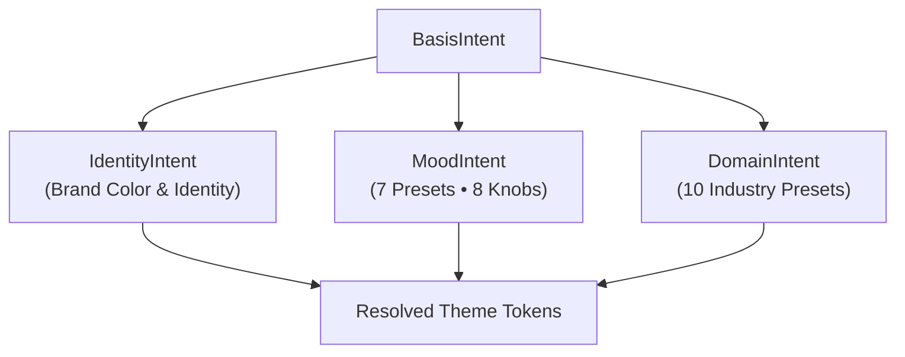

`BasisIntent` is the root configuration structure for Basis themes. It captures your brand identity and aesthetic preferences across three modular sub-intents:



## Quick Example

```kotlin
val myIntent = BasisIntent(
    identity = IdentityIntent(
        seedColor = "#0284C7", // Sky blue brand seed
        brandName = "Acme Console"
    ),
    mood = MoodIntent(
        preset = MoodIntent.Preset.Refined,
        density = 0.2f,        // Slightly more compact spacing
        contrast = 0.15f       // Slightly crisper borders
    ),
    domain = DomainIntent(
        domain = DomainIntent.Domain.Developer
    )
)
```

## 1. IdentityIntent

`IdentityIntent` establishes your chromatic anchor:

| Field | Type | Default | Description |
| :--- | :--- | :--- | :--- |
| **`seedColor`** | `String` (Hex) | `"#3B82F6"` | Primary brand color. Basis extracts hue and chroma to derive buttons, containers, and accents. |
| **`brandName`** | `String` | `"Default"` | The human-readable product name used in diagnostics and reports. |
| **`secondarySeedColor`** | `String?` | `null` | Optional secondary accent color for split-theme branding. |

## 2. MoodIntent

`MoodIntent` controls the emotional tone, roundness, and spatial density of your interface.

### The 7 Mood Presets

| Preset | Visual Character | Corner Shape | Saturation Feel |
| :--- | :--- | :--- | :--- |
| **`Balanced`** | Modern baseline for general consumer apps | Medium (8dp) | Natural, balanced saturation |
| **`Refined`** | Crisp, understated, and professional | Crisp (4dp) | Subdued chroma, subtle elevation |
| **`Energetic`** | High-energy, bold, and dynamic | Dynamic | Saturated accents, punchy contrast |
| **`Calm`** | Soft, peaceful, and relaxed | Soft (12dp) | Pastel accents, gentle boundaries |
| **`Technical`** | High information clarity, minimal decoration | Sharp (2dp) | High contrast, dense layout |
| **`Playful`** | Approachable, fun, and friendly | Rounded (16dp) | Warm, bouncy, and colorful |
| **`Warm`** | Cozy, inviting, and organic | Soft (10dp) | Amber undertones, warm surfaces |

### The 8 Continuous Aesthetic Knobs

To customize beyond presets, adjust any of the eight continuous knobs from `-1.0` (minimum) to `+1.0` (maximum):

| Knob | Range | Default | Negative Impact (-1.0) | Positive Impact (+1.0) |
| :--- | :--- | :--- | :--- | :--- |
| **`chroma`** | `[-1.0, 1.0]` | `0.0` | Monochromatic / neutral grays | Saturated, vibrant accents |
| **`warmth`** | `[-1.0, 1.0]` | `0.0` | Cool slate / blue undertones | Warm stone / amber undertones |
| **`contrast`** | `[-1.0, 1.0]` | `0.0` | Soft, subtle surface separation | Crisp, high-definition boundaries |
| **`depth`** | `[-1.0, 1.0]` | `0.0` | Flat, minimal elevation | Dimensional, layered elevation |
| **`sharpness`** | `[-1.0, 1.0]` | `0.0` | Soft, rounded organic corners | Crisp, geometric sharp edges |
| **`density`** | `[-1.0, 1.0]` | `0.0` | Airy, spacious layout gaps | Compact, space-efficient padding |
| **`prominence`** | `[-1.0, 1.0]` | `0.0` | Quiet, understated buttons | Bold, dominant action triggers |
| **`expressiveness`**| `[-1.0, 1.0]` | `0.0` | Restrained functional motion | Dynamic, animated choreography |

## 3. DomainIntent

`DomainIntent` configures industry-tailored defaults:

| Domain | Optimized For | Key Characteristics |
| :--- | :--- | :--- |
| **`Productivity`** | Daily task workflows & forms | Clean typography, compact fields, crisp focus rings |
| **`Finance`** | Banking & investment apps | High-contrast tabular numbers, conservative elevation |
| **`Healthcare`** | Medical & wellness portals | Calming surfaces, high text legibility, prominent buttons |
| **`Developer`** | Consoles & code environments | Dense spacing, dark-mode optimization, monospace accents |
| **`Commerce`** | Retail & marketplace apps | Bold action triggers, prominent product framing |
| **`Reader`** | Long-form reading & articles | Generous line-heights, paper-like warmth, subdued borders |
| **`Dashboard`** | Multi-column analytics | High data density, structured grid boundaries |
| **`Social`** | Feeds & messaging platforms | Avatar framing, energetic interactive badges |
| **`Media`** | Video, audio, & photography | Immersive dark canvases that highlight media assets |
| **`Generic`** | Balanced default | Standard Android application baseline |

## Next Steps

- [ThemeMode](/docs/theming/theme-mode): Learn how light and dark modes interact with your intent.
- [Overrides](/docs/theming/overrides): Apply surgical style patches to individual components.
