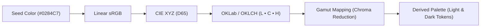
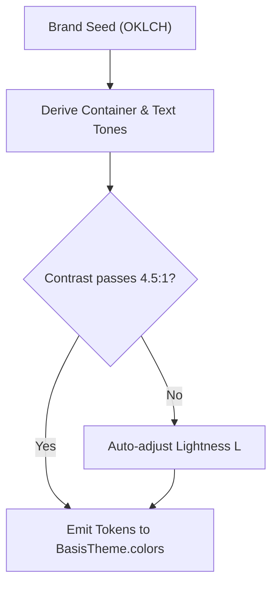

Basis calculates all color palettes in the **OKLCH** color space (`Lightness`, `Chroma`, `Hue`). This ensures that colors have uniform perceived brightness across all hues, guaranteeing text legibility and preventing muddy or blinding container tones.

## The Flaw in Traditional HSL

In legacy design systems, themes are often calculated using standard HSL (Hue, Saturation, Lightness). However, human vision is significantly more sensitive to green and yellow light than to blue light:

| Color | HSL Value | Perceived Brightness (OKLCH L) | Legibility with White Text |
| :--- | :--- | :--- | :--- |
| **Pure Yellow** | `hsl(60, 100%, 50%)` | **0.97** (Nearly White) | ❌ Illegible (1.1:1 Contrast) |
| **Pure Blue** | `hsl(240, 100%, 50%)` | **0.45** (Dark Navy) | ✅ Clear (8.5:1 Contrast) |

Because HSL treats both colors as having "50% lightness", automated theme generators using HSL produce unreadable white-on-yellow text whenever a user picks a warm brand seed.

## The OKLCH Advantage

OKLCH corrects for human eye physiology using three intuitive coordinates:

| Coordinate | Name | Range | Description |
| :--- | :--- | :--- | :--- |
| **`L`** | **Perceived Lightness** | `[0.0, 1.0]` | Linear perceived brightness. An `L` of 0.7 appears equally bright regardless of hue. |
| **`C`** | **Chroma** | `[0.0, 0.4+]` | Purity and saturation. 0.0 is pure neutral gray; higher values yield vivid color. |
| **`H`** | **Hue Angle** | `[0°, 360°]` | Angular position on the perceptual color circle (e.g. 25° red, 140° green, 260° blue). |

## Contrast Mathematics

Because OKLCH lightness corresponds directly to human luminance perception, Basis calculates and enforces WCAG 2.1 AA relative contrast deterministically:

Whenever an input brand color would result in sub-threshold contrast against a light or dark container, the resolver shifts the lightness coordinate (`L`) until the **4.5:1 normal text** or **3.0:1 control boundary** floor is achieved.

## Gamut Mapping for Android Displays

Intense OKLCH calculations can occasionally produce coordinates outside standard sRGB display gamuts. Rather than clamping channels (which causes harsh hue shifts), Basis applies **chroma-reduction gamut mapping**:

1. **Preserves Hue (`H`)**: The color never shifts from blue to purple or green to yellow.
2. **Preserves Lightness (`L`)**: Contrast ratios remain strictly protected.
3. **Reduces Chroma (`C`)**: Decreases saturation just enough to fit comfortably within the device's display gamut.

The result is vivid, attractive color that renders identically across both standard LCDs and wide-gamut OLED screens.

## Next Steps

- [Resolution & Diagnostics](/docs/theming/resolution): How the resolver audits contrast and emits reports.
- [Overrides](/docs/theming/overrides): Customizing component styles while preserving contrast invariants.
