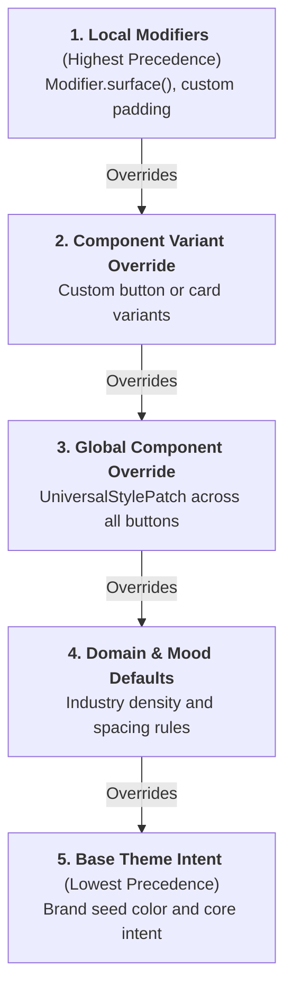

While global intent rules govern 95% of your application, specific screens or promotional components require surgical visual adjustments. Basis provides a structured **Overrides** system that allows targeted styling without breaking systemic accessibility floors.



## The 10 Universal Style Properties

All interactive composables and surfaces in Basis support ten standardized style properties:

| Property | Type | Description |
| :--- | :--- | :--- |
| **`background`** | `Color` | Container fill color. Automatically updates `LocalBasisContentColor`. |
| **`contentColor`** | `Color` | Foreground color applied to child text and icons. |
| **`borderColor`** | `Color` | Stroke color for outline boundaries. |
| **`borderWidth`** | `Dp` | Thickness of the outline boundary. |
| **`cornerRadius`** | `Dp` | Corner rounding radius. |
| **`elevation`** | `Dp` | Depth index (ambient shadow in light mode; tonal lightness in dark mode). |
| **`padding`** | `PaddingValues` | Internal padding between container boundary and content. |
| **`spacing`** | `Dp` | Gap spacing between child elements (e.g. icon and label). |
| **`opacity`** | `Float` | Alpha transparency (`0.0` to `1.0`). |
| **`interactionSource`** | `MutableInteractionSource` | Interaction state stream for hover, press, and focus. |

## Applying Overrides

### 1. Global Component Overrides

To modify the default appearance of all buttons or surfaces across your application, declare overrides in your `ControlIntent`:

```kotlin
val customIntent = BasisIntent(
    identity = IdentityIntent(seedColor = "#0284C7"),
    control = ControlIntent(
        overrides = ComponentOverrides(
            button = UniversalStylePatch(
                cornerRadius = 12.dp, // Give all buttons a softer 12dp radius
                borderWidth = 1.dp
            )
        )
    )
)
```

### 2. Local Instance Customization

For single-instance styling, apply standard Jetpack Compose parameters or modifiers directly to the composable:

```kotlin
BasisButton(
    onClick = { /* checkout */ },
    variant = BasisButtonDefaults.variantPrimary(),
    modifier = Modifier
        .fillMaxWidth()
        .padding(BasisTheme.spacing.md)
) {
    Text("Complete Checkout")
}
```

## Enforced Invariants During Overrides

Overrides allow creative visual styling while guaranteeing that core accessibility contracts remain intact:

- **Touch Target Floor**: Even if you reduce a button's visual padding to `4.dp`, Basis automatically preserves the **48dp minimum physical touch target** via `Modifier.touchTarget()` to prevent missed taps.
- **Content Color Propagation**: When you override a container's `background`, `LocalBasisContentColor` automatically updates so that child text and icons maintain readable contrast against the new background.

## Next Steps

- [Surface Foundation](/docs/foundation/surface): Inspect how surfaces coordinate background tone and content color.
- [BasisButton Component](/docs/components/button): Explore all available button variants and parameters.
