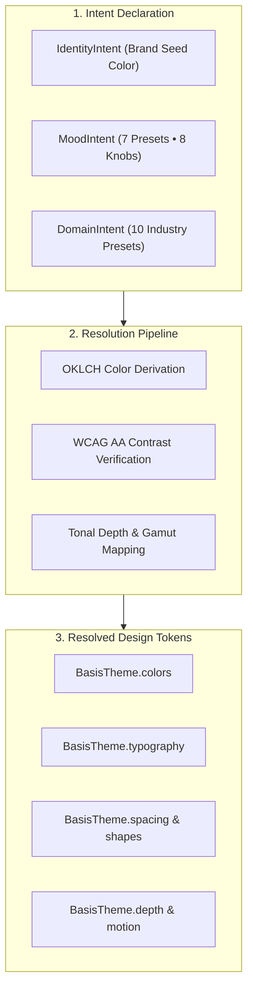

Basis theming replaces manually maintained style constants with an algorithmic compilation pipeline. You define your aesthetic goals once in a `BasisIntent`, and the engine derives concrete, accessible token trees for both light and dark environments.

## How It Works

1. **Declare Intent**: Specify your brand seed color and visual personality via `BasisIntent`. You never define individual button hover states, border hairlines, or surface shades by hand.
2. **Compile Tokens**: `ThemeResolver` processes your intent through perceptual color math, maps colors to device gamuts, and verifies that every foreground/background combination passes accessibility thresholds.
3. **Consume in Compose**: The compiled tokens are provided through `CompositionLocal` environments, accessible anywhere via `BasisTheme`.

## The Token Hierarchy

Every resolved theme exposes six primary token families directly to Jetpack Compose:

| Token Family | Accessor | Content & Units | Purpose |
| :--- | :--- | :--- | :--- |
| **Color** | `BasisTheme.colors` | `Color` (OKLCH derived) | Semantic surfaces, containers, borders, text, and status states. |
| **Typography** | `BasisTheme.typography` | `TextStyle` (sp, em) | Proportional hierarchy from `displayLarge` down to `labelSmall`. |
| **Spacing** | `BasisTheme.spacing` | `Dp` (4dp grid) | Predictable spatial rhythm from `xxs` (2dp) to `xxxl` (64dp). |
| **Shapes** | `BasisTheme.shapes` | `CornerBasedShape` | Corner rounding from `sharp` (0dp) to `full` (pill shape). |
| **Depth** | `BasisTheme.depth` | `Dp`, `Elevation` | Shadows in light mode; luminous lightness steps in dark mode. |
| **Motion** | `BasisTheme.motion` | `Duration`, `Easing` | Choreographed transitions from `short1` (50ms) to `long4` (600ms). |

## Light and Dark Parity

Rather than maintaining separate theme files for light and dark modes, Basis resolves both palettes simultaneously from your intent:

- **Light Mode**: Generates crisp, high-luminance surfaces with natural ambient drop shadows.
- **Dark Mode**: Automatically activates tonal elevation, stepping surface lightness rather than relying on invisible dark-on-dark shadows.

Both modes are guaranteed to have matching semantic roles, allowing you to build screens once without conditional styling logic.

## Section Guide

- [Philosophy](/docs/theming/philosophy): Why intent-driven theming eliminates design debt.
- [Intent Model](/docs/theming/intent): Complete reference for Identity, Mood knobs, and Domain presets.
- [ThemeMode](/docs/theming/theme-mode): Runtime switching between Light, Dark, and System modes.
- [OKLCH Color](/docs/theming/oklch): Perceptual uniformity and automated contrast mathematics.
- [Resolution & Diagnostics](/docs/theming/resolution): Validation reports and theme unit testing.
- [Overrides](/docs/theming/overrides): Surgical component styling and the 10 universal style properties.
