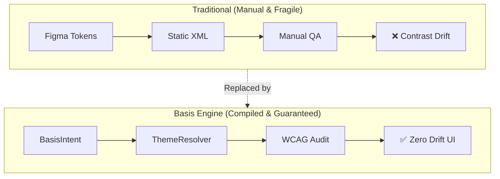

Basis treats theming as a compiled software system rather than a collection of static design assets. By establishing strict mathematical invariants, Basis guarantees that aesthetic changes never introduce contrast regressions, inaccessible touch targets, or broken dark mode hierarchy.



## The Four Invariants

Every theme generated by Basis must strictly satisfy four core invariants:

### 1. The Accessibility Invariant (WCAG 2.1 AA)
Contrast is validated mathematically during derivation rather than during QA spot-checks:

- **Normal Body Text**: Must achieve a minimum contrast ratio of **4.5:1** against underlying surfaces.
- **Large Text & Headings**: Must achieve a minimum contrast ratio of **3.0:1**.
- **Interactive Boundaries & Focus Rings**: Must achieve a minimum contrast ratio of **3.0:1**.

If an input seed color fails these ratios, the resolver automatically shifts perceptual luminance to satisfy the threshold before any composable renders.

### 2. The Spatial Invariant (48dp Touch Floor)
Human fingers require minimum physical contact areas to operate reliably. Every interactive composable and foundation modifier in Basis automatically expands tap bounds to meet the **48dp minimum touch target floor**, regardless of how compact the visual styling appears.

### 3. The Tonal Depth Invariant
Traditional drop shadows fail in dark mode because dark backgrounds absorb shadows, flattening UI depth. Basis enforces **Tonal Elevation**: surfaces increase in luminous lightness as their elevation index rises:

```
Canvas (L: 0.12) ──► Card (L: 0.16) ──► Dialog / Sheet (L: 0.22)
```

Developers use the same semantic depth tokens (`BasisTheme.depth.level1`, `level2`) across all modes without writing conditional branches.

### 4. The Parity Invariant
The theme resolution engine is implemented as a pure multiplatform compiler. Passing the identical `BasisIntent` produces byte-for-byte identical token trees on Android, JVM desktop, and web documentation runtimes.

## Next Steps

- [Intent Model](/docs/theming/intent): Learn how to configure your brand identity and mood knobs.
- [OKLCH Color](/docs/theming/oklch): Discover the perceptual mathematics behind the color engine.
