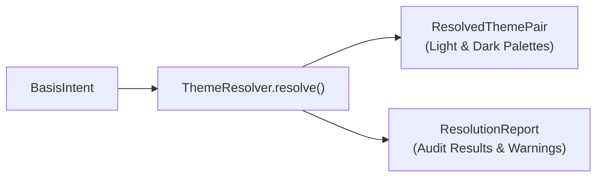

When your application initializes `BasisTheme`, the `ThemeResolver` compiles your `BasisIntent` into a `ResolvedThemePair` containing concrete light and dark token palettes, accompanied by a diagnostic `ResolutionReport`.



## The Resolution Audit

During compilation, every semantic pairing is audited against accessibility thresholds:

| Pairing | Target Element | Minimum Ratio | WCAG Standard |
| :--- | :--- | :--- | :--- |
| **`onPrimary` on `primary`** | Primary button labels | $\ge 4.5:1$ | AA Normal Text |
| **`onSurface` on `surface`** | Body typography | $\ge 4.5:1$ | AA Normal Text |
| **`onSurfaceVariant` on `surfaceVariant`** | Secondary captions | $\ge 4.5:1$ | AA Normal Text |
| **`outline` on `surface`** | Card & input borders | $\ge 3.0:1$ | AA UI Component |
| **`focusRing` on `surface`** | Keyboard focus indicator | $\ge 3.0:1$ | AA Focus Visible |

## The `ResolutionReport` Structure

The `ResolutionReport` provides diagnostic visibility into how your intent was compiled:

```kotlin
val result = ThemeResolver.resolve(AppThemeIntent)
val report = result.report

// 1. Check whether theme compiled cleanly
val isValid: Boolean = report.isValid

// 2. Inspect non-fatal diagnostic notices (e.g. gamut clipping, contrast adjustments)
val warnings: List<ThemeWarning> = report.warnings

// 3. Inspect computed contrast scores for specific pairings
val primaryContrast: Float = report.contrastScores["onPrimary_primary"] ?: 0f
```

### Common Diagnostic Warnings

- **`GamutReductionWarning`**: Notifies you that an intense chroma seed was reduced slightly to prevent color clipping on sRGB displays.
- **`ContrastAdjustmentNotice`**: Notifies you that an input seed color was lightened or darkened to guarantee the 4.5:1 text contrast floor.

## Unit Testing Your Theme in CI

You can add theme resolution directly to your automated test suite to ensure that team brand adjustments never introduce unexpected contrast failures:

```kotlin
import io.github.alph_a07.basis.theme.resolution.ThemeResolver
import org.junit.Assert.assertTrue
import org.junit.Test

class ThemeComplianceTest {

    @Test
    fun appThemeResolvesWithoutErrors() {
        val result = ThemeResolver.resolve(AppThemeIntent)

        // Verify compilation succeeds
        assertTrue("Theme failed to compile", result.report.isValid)

        // Ensure no severe contrast violations occurred
        val severeIssues = result.report.warnings.filter { it.isSevere }
        assertTrue("Severe theme warnings detected: $severeIssues", severeIssues.isEmpty())
    }
}
```

## Next Steps

- [Overrides](/docs/theming/overrides): Customize component styles without breaking accessibility floors.
- [Foundation Atoms](/docs/foundation/surface): Inspect how surfaces and focus rings consume resolved tokens.
