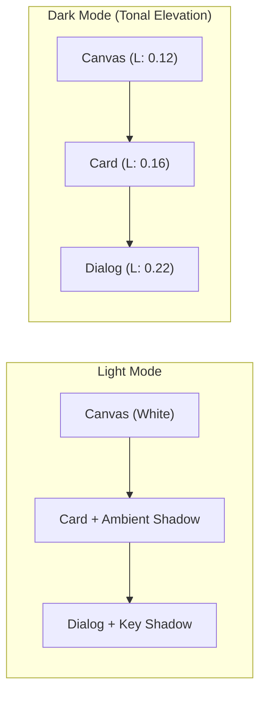

Basis treats Light and Dark modes as two distinct perceptual environments rather than simple color inversions. With `ThemeMode`, your application seamlessly toggles between daytime clarity and comfortable nighttime hierarchy.



## The `ThemeMode` Options

```kotlin
enum class ThemeMode {
    Light,  // Forces light palette
    Dark,   // Forces dark palette with tonal elevation
    System  // Automatically tracks the Android OS system setting
}
```

- **`ThemeMode.System` (Recommended)**: Follows the device's system setting, adapting automatically when the user toggles dark mode in Quick Settings or on a sunset schedule.
- **`ThemeMode.Light`**: Renders the light palette regardless of device settings.
- **`ThemeMode.Dark`**: Renders the dark palette with tonal elevation regardless of device settings.

## Tonal Elevation in Dark Mode

Traditional drop shadows disappear on dark canvases, causing cards and modal dialogs to look flat and indistinguishable. Basis solves this through **Tonal Elevation**:

| Elevation Level | Light Mode Representation | Dark Mode Representation | Use Case |
| :--- | :--- | :--- | :--- |
| **`BasisTheme.depth.level0`** | Flat surface, no shadow | Base canvas luminance (`L: 0.12`) | Background screen scaffold |
| **`BasisTheme.depth.level1`** | Subtle 1dp ambient shadow | First tonal step (`L: 0.15`) | List items, inline banners |
| **`BasisTheme.depth.level2`** | 3dp key & ambient shadow | Elevated card step (`L: 0.18`) | Interactive cards, tiles |
| **`BasisTheme.depth.level3`** | 6dp prominent shadow | Prominent tonal step (`L: 0.22`) | Floating action bars, menus |
| **`BasisTheme.depth.level4`** | 12dp modal shadow | Highest luminous step (`L: 0.26`) | Modal dialogs, bottom sheets |

Because elevation is expressed through semantic tokens, you never need to write conditional `if (isDark)` statements in your Compose UI.

## Implementing Theme Toggling

Here is an idiomatic Jetpack Compose pattern for an in-app theme switcher:

```kotlin
@Composable
fun App() {
    var themeMode by remember { mutableStateOf(ThemeMode.System) }

    BasisTheme(mode = themeMode) {
        Scaffold { padding ->
            ThemeSelector(
                selectedMode = themeMode,
                onModeSelected = { themeMode = it },
                modifier = Modifier.padding(padding)
            )
        }
    }
}

@Composable
fun ThemeSelector(
    selectedMode: ThemeMode,
    onModeSelected: (ThemeMode) -> Unit,
    modifier: Modifier = Modifier
) {
    Column(modifier = modifier.padding(BasisTheme.spacing.md)) {
        Text(
            text = "Appearance",
            style = BasisTheme.typography.titleMedium,
            color = BasisTheme.colors.onSurface
        )

        Spacer(modifier = Modifier.height(BasisTheme.spacing.sm))

        ThemeMode.entries.forEach { mode ->
            Row(
                modifier = Modifier
                    .fillMaxWidth()
                    .clickable { onModeSelected(mode) }
                    .padding(vertical = BasisTheme.spacing.sm),
                horizontalArrangement = Arrangement.SpaceBetween,
                verticalAlignment = Alignment.CenterVertically
            ) {
                Text(
                    text = when (mode) {
                        ThemeMode.System -> "Follow system settings"
                        ThemeMode.Light -> "Light theme"
                        ThemeMode.Dark -> "Dark theme"
                    },
                    style = BasisTheme.typography.bodyMedium,
                    color = BasisTheme.colors.onSurface
                )

                RadioButton(
                    selected = (selectedMode == mode),
                    onClick = { onModeSelected(mode) }
                )
            }
        }
    }
}
```

## Next Steps

- [OKLCH Color](/docs/theming/oklch): Learn how the color engine derives uniform lightness across all hues.
- [Surface Foundation](/docs/foundation/surface): Inspect how surfaces coordinate background tone and content color.
